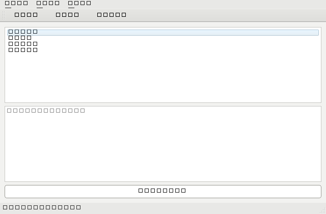
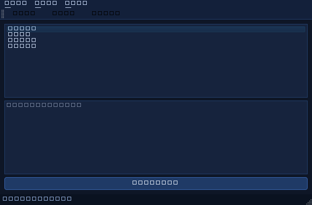
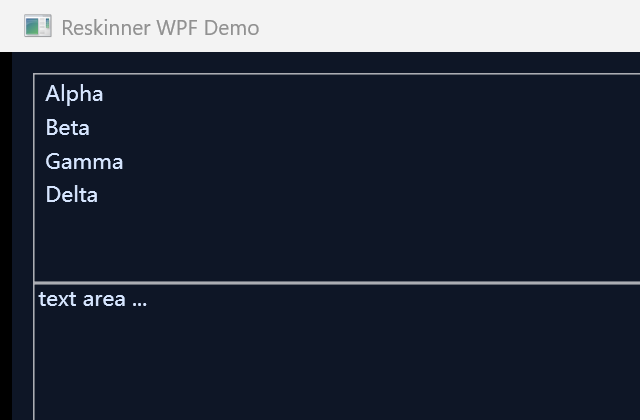
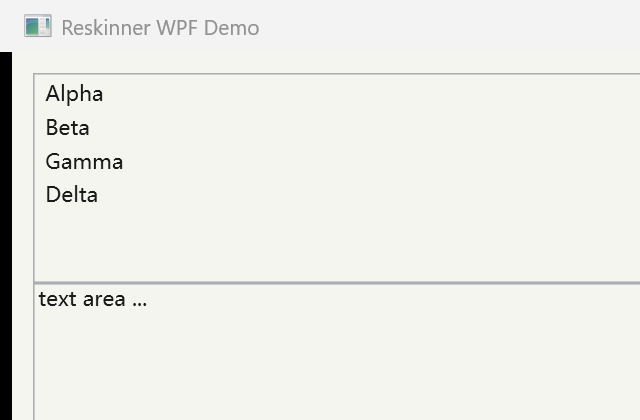
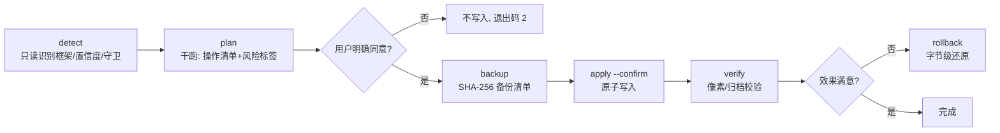

# desktop-ui-reskinner

> 供 AI 智能体一键调用的**桌面软件通用换肤工具箱 Skill**：输入任意桌面软件，自动识别其 UI 框架，直通 UI 层完成资源/样式定位、改色改图、落地生效，全程**默认只读、强制备份、一键回滚**。

`License: MIT` · `Platform: Windows 10/11` · `Runtime: Python 3.9+（零强制第三方依赖）` · `Skill: AI Agent callable`

---

## 这是什么

不是改造某一个软件的补丁，而是一条**可复用、可审计、可回滚**的工具链。AI 智能体通过唯一 CLI 完成六步：

```
detect（只读识别框架） → plan（干跑列出改动与风险） → 用户确认 → backup（强制备份）
→ apply --confirm（原子写入） → verify（像素/归档校验） → rollback（随时字节级还原）
```

主路径是**静态资源替换**（Qt 的 qss、Electron 的 app.asar 成员、WPF 的外挂 ResourceDictionary、Win32 的 PE 资源段）；
运行时注入 / Hook 明确不在工具箱能力范围内。

## 效果对照（真实自建靶场截图）

### Qt（PySide6）：浅色 → 深蓝暗色 → 一键回滚

<table>
<tr>
<td align="center"><br>before · 亮度均值 246.26</td>
<td align="center"><br>after · 亮度 34.99（R22/G36/B62，蓝占优）</td>
<td align="center"><br>rollback · 与 before <b>0 像素差异</b></td>
</tr>
</table>

验证方式：`QT_QPA_PLATFORM=offscreen` 离屏渲染 + `QWidget.grab()`，逐像素统计。报告：[`verification/qt-pyside6/verify-report.json`](verification/qt-pyside6/verify-report.json)

### WPF（.NET Framework code-only 靶场）：外挂 ResourceDictionary 换肤

<table>
<tr>
<td align="center"><br>before · 亮度均值 237.57</td>
<td align="center"><br>after · 亮度 51.36（R45/G52/B66）</td>
<td align="center"><br>rollback · 与 before <b>0 像素差异</b></td>
</tr>
</table>

验证方式：`csc.exe` 实际编译出 WpfDemo.exe + Win32 `PrintWindow(PW_RENDERFULLCONTENT)` 截图。报告：[`verification/wpf-codeonly/verify-report.json`](verification/wpf-codeonly/verify-report.json)

> Electron（app.asar 成员级替换）在本环境完成了**归档级**验证（窗口可启动；Chromium GPU 合成客户区无法被 PrintWindow 捕获，未取得像素对照），详见 [案例复盘](docs/02-case-studies.md#三electronasar-成员级替换归档级验证)。

## 工作流



- **只读步骤**：detect / plan / verify（不带写入参数时）。
- **必须用户确认**：apply 的 `--confirm`；Agent 调用时须先把 plan 结果展示给用户并取得明确同意，自有靶场也不例外。
- 退出码：`0` 成功；`2` 干跑/存在阻断项，**未写入**；其余非 0 为错误。

## 框架识别决策树

```
目标目录
 ├─ resources\app.asar / ffmpeg.dll / locales\*.pak ──────▶ electron（UI = asar 内 HTML/CSS/JS）
 │   └─ 检测到 asarIntegrity / Fuses ──▶ 直接拒写，引导官方主题系统
 ├─ libcef.dll / cef.pak / icudtl.dat ────────────────────▶ cef（只识别，不主动改包）
 ├─ Qt6Core.dll / Qt5Core.dll / PySide6 / PyQt6 / qwindows.dll / *.qss ──▶ qt（外部 qss/rcc）
 ├─ PresentationFramework / PresentationCore / *.exe.config / g.resources ──▶ wpf（不回编 BAML）
 ├─ System.Windows.Forms ─────────────────────────────────▶ winforms（图片/颜色资源）
 └─ 其余 PE 兜底 ────────────────────────────────────────▶ win32（low 置信，PE 资源段/配置层）
```

## 快速开始（Windows PowerShell）

```powershell
# 0)（可选）准备 Qt 靶场运行环境 —— reskin.py 本体零 pip 依赖，仅截图/启动靶场需要
python -m venv .venv
.\.venv\Scripts\python -m pip install PySide6 -i https://pypi.tuna.tsinghua.edu.cn/simple

# 1) 只读识别
python desktop-ui-reskinner\scripts\reskin.py --json detect --target demo-targets\qt-pyside6
# 2) 干跑（退出码 2，不写盘）
python desktop-ui-reskinner\scripts\reskin.py --json plan   --target demo-targets\qt-pyside6 --skin examples\skin-packs\qt-dark-blue
# 3) 确认计划后写入（自动备份到目标目录 .reskin-backups\<时间戳>\）
python desktop-ui-reskinner\scripts\reskin.py --json apply  --target demo-targets\qt-pyside6 --skin examples\skin-packs\qt-dark-blue --confirm
# 4) 校验 / 回滚
python desktop-ui-reskinner\scripts\reskin.py --json verify --target demo-targets\qt-pyside6
python desktop-ui-reskinner\scripts\reskin.py --json rollback --target demo-targets\qt-pyside6
```

可选工具链：

| 组件 | 用途 | 准备 |
|---|---|---|
| Node.js 22+ / `@electron/asar` | Electron 路线 | `winget install OpenJS.NodeJS.LTS`；`npm install @electron/asar --registry=https://registry.npmmirror.com`（设 `$env:ELECTRON_MIRROR='https://npmmirror.com/mirrors/electron/'` 加速二进制） |
| Resource Hacker | Win32 PE 资源段 | <https://www.angusj.com/resourcehacker/> 或 `winget install AngusJ.ResourceHacker` |
| .NET SDK 8（可选） | WPF 反编译查看（ilspycmd） | `winget install Microsoft.DotNet.SDK.8`（仅看，不回编 BAML） |

**安装为 Agent Skill**：把 `desktop-ui-reskinner` 整目录复制到 `C:\Users\<你>\.agents\skills\desktop-ui-reskinner`，智能体即可按其中 `SKILL.md` 的决策树与检查清单调用。

## 支持矩阵

| 框架 | 识别信号 | UI 层可改形态 | 工具箱成熟度 |
|---|---|---|---|
| **Qt**（PySide/PyQt/C++ Qt） | Qt*Core.dll、qwindows.dll、PySide6、*.py 导入、*.qss | 外部 qss / 外部 rcc / 配置 | ✅ **已端到端验证**（像素级 before/after/回滚） |
| **WPF** | PresentationFramework 字节特征、*.exe.config、g.resources | 外挂松散 ResourceDictionary、官方主题库设置 | ✅ **已端到端验证**（code-only 靶场；BAML 内嵌资源只读） |
| **Electron** | app.asar、ffmpeg.dll、locales pak | asar 内 CSS/HTML 成员级替换 | 🟡 **已归档级验证**（成员替换+回滚字节校验通过；像素截图受 Chromium 合成限制） |
| **CEF** | libcef.dll、cef.pak、icudtl.dat | 应用自带 HTML / 远程 URL | ⚪ 仅检测与方法论（.pak 不改） |
| **WinForms** | System.Windows.Forms 特征 | 图片/颜色资源 | ⚪ 仅检测与方法论（.NET 托管资源 v1 不做） |
| **Win32 原生** | PE 兜底 | RT_ICON/RT_BITMAP/RT_DIALOG/配置文件 | ⚪ 检测 + `pe_resource` 原语（本机未安装 Resource Hacker，未做真机端到端） |

## 安全设计

- **默认 dry-run**：不带 `--confirm` 绝不写盘；plan 输出操作清单、风险标签与备份位置。
- **强制备份**：每个被改文件记录大小 / mtime / **SHA-256**，写前备份；rollback 逐文件 hash 校验。
- **路径 containment**：换肤包内所有目标路径必须落在 target 根目录内，`..\` 越界一律拒绝（有回归测试）。
- **守卫检测**：Authenticode 签名、Electron asarIntegrity/Fuses、.NET 强命名、Program Files 目录、进程占用、目录可写性。
- **基线 hash 防覆盖**：目标文件与上次备份基线不一致时阻断，防止覆盖用户手动修改或自动更新后的文件。
- **失败自动回滚**：多操作事务中任一失败，已完成操作按本次备份自动还原。
- **明确不提供**：不翻转 Electron Fuses、不重算 asarIntegrity、不伪造/重签名、不做 DLL 注入 / API Hook / 进程内存修改 / exe 补丁式字节改写。

## 目录结构

```
.
├─ desktop-ui-reskinner/          # Skill 本体（复制到用户级 skills 目录即可被 Agent 调用）
│  ├─ SKILL.md                    # 决策树 + 工作流 + 工具链 + 检查清单 + 回滚 + 合规
│  ├─ scripts/reskin.py           # 唯一 CLI（六个子命令，--json）
│  ├─ scripts/asar_pack.js        # @electron/asar 成员级替换
│  ├─ templates/                  # 换肤包骨架（qt/electron/win32 + 通用模板）
│  ├─ docs/                       # 五篇框架速查
│  ├─ references/case-index.md    # 业界案例索引
│  └─ tests/                      # 合成夹具 + run-tests.ps1（31/31 通过）
├─ demo-targets/                  # 三个自建最小靶场（qt-pyside6 / electron-demo / wpf-codeonly）
├─ examples/skin-packs/           # 三个可直接使用的换肤包
├─ verification/                  # before/after/restored 截图 + 验证报告 + 截图脚本
├─ research/                      # 阶段① 业界案例库（Qt/Win32、Electron/CEF、WPF/WinForms）
├─ design/skill-interface-spec.md # 冻结的 CLI/manifest/安全接口规范
├─ docs/                          # 架构深潜 / 靶场复盘 / GitHub 发布指南
├─ LICENSE                        # MIT
└─ DISCLAIMER.md                  # 合规与免责声明
```

> `.venv/`、`.tools/`、`demo-targets/electron-demo/App/`、`*.exe`、`.reskin-backups/` 等大体积/运行时产物已在 `.gitignore` 中，均可由各 `build.ps1` / pip / npm 命令从零重建。

## 文档

- [01 · 技术架构深潜](docs/01-architecture.md)：CLI JSON 契约、置信度模型、四种操作原语、备份清单、守卫策略、manifest 字段
- [02 · 靶场实战复盘](docs/02-case-studies.md)：Qt / WPF / Electron 三篇，含真实像素数值与踩坑修复过程
- [03 · 发布到 GitHub](docs/03-publish-to-github.md)：本地 git 初始化到推送的完整步骤
- [案例库 · Qt 与 Win32](research/cases-qt-win32.md) · [Electron 与 CEF](research/cases-electron-cef.md) · [WPF 与 WinForms](research/cases-wpf-winforms.md)

## 合规与免责（务必先读）

本项目仅限**个人学习研究、互操作、对自有软件或开源软件做 UI 美化**。严禁用于破解、授权绕过、付费功能解锁、去除版权标识，严禁分发修改后的闭源商业软件。

- 对带 Authenticode 签名 / 强名称 / asar integrity / Fuses 的程序，修改会破坏完整性校验——工具箱检测到这些守卫时的职责是**告知此路不通并降级到官方主题系统**，不提供任何绕过能力。
- 闭源商业客户端（微信/QQ/Discord/Spotify/钉钉/Teams 等）的第三方改包通常违反服务条款，可能导致封号与法律责任；本仓库对其仅做方法论分析。
- 详见 [LICENSE](LICENSE)（MIT）与 [DISCLAIMER.md](DISCLAIMER.md)。
